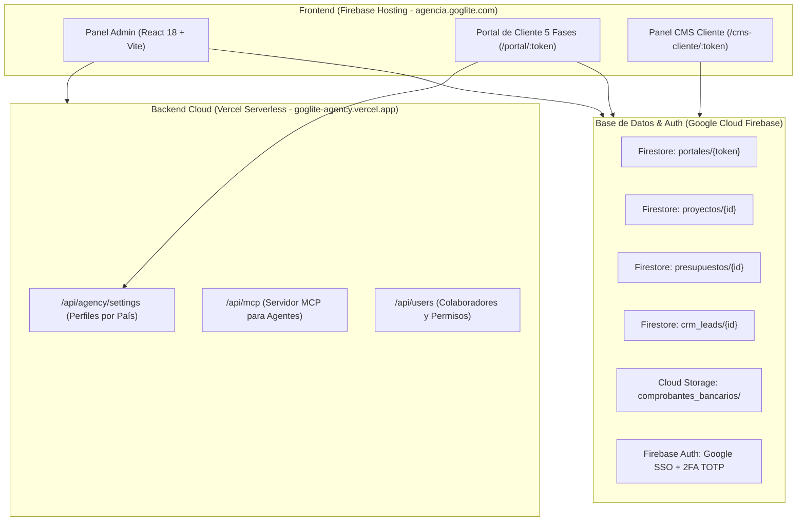

# 🚀 Documento Maestro de Progreso & Estado Técnico

**Plataforma:** Goglite Digital Hub (`agencia.goglite.com`)  
**Fecha de corte:** 25 de Octubre de 2026  
**Hora de actualización:** 22:50 (Hora local)  
**Propósito:** Consolidar el estado de avance, las funcionalidades implementadas, la arquitectura en la nube y la hoja de ruta exacta para continuar la sesión de mañana.

---

## 📌 1. Resumen Ejecutivo de la Sesión de Hoy

Durante esta sesión se completó la transición hacia una arquitectura **100% Cloud-First**, desacoplada de la computadora local, multi-sede internacional y con purga total de datos de prueba:

1. **Servidor MCP en la Nube:** Migrado y configurado en Vercel Serverless (`https://goglite-agency.vercel.app/api/mcp`) para garantizar que los agentes de IA puedan interactuar con la plataforma las 24 horas del día aunque la computadora esté apagada.
2. **Edición Manual de Leads en CRM:** Incorporado modal de edición completa en la Ficha 360 del Lead (Nombre, Empresa, Teléfono, Correo, Presencia Digital, Actividad Comercial y Notas).
3. **Catálogo Oficial de Servicios en Ajustes:** Gestor visual dinámico en la Pestaña 6 de Ajustes para dar de alta, modificar y eliminar servicios y paquetes, integrados en tiempo real al generador de presupuestos.
4. **Perfiles de Empresa por País (Multi-Sede):** Pestaña 3 de Ajustes segregada en sedes independientes (🇩🇴 República Dominicana, 🇸🇻 El Salvador, 🇺🇸 Estados Unidos) como fuente única de verdad para Razón Social, RNC/NIT/EIN, Dirección física, WhatsApp oficial y Director responsable.
5. **Purga Total de Mockups de Desarrollo:** Eliminación completa de números ficticios (`809-408-8070`, `50370001122`) y direcciones simuladas en Piantini.
6. **Resolución Automática por Procedencia de Cliente:** Las propuestas y portales asignan automáticamente los datos de contacto y facturación del país correspondiente al cliente (ej. República Dominicana para *TurisRan*).
7. **Estabilidad del Portal y Prevención de Pantallas Negras:** Corrección de dependencias circulares, orden de inicialización de hooks y contenedor `<ErrorBoundary>` global y modular.
8. **Saneamiento de Enlaces del Portal de Cliente:** Diagnóstico y corrección del error de desbordamiento de URL (URLs de 347 KB generadas por adjuntar comprobantes bancarios en base64). Se implementó la estructura de enlace canónico limpio (`/portal/:token`) con sincronización automática en Firestore.
9. **Corrección de Formulario y Botón de Pago en Fase 4 (Liquidación):** Solución al problema donde, al subir la captura bancaria, la interfaz eliminaba prematuramente los controles de carga y ocultaba el botón "Ya hice el pago". Se rediseñó el flujo para retener la botonera con estado del comprobante (`[Ver]` y `[Cambiar]`) y el botón de acción principal activo (`"✓ Ya hice el pago · Notificar Liquidación Final ($... USD)"`), transitando a verificación únicamente tras el envío explícito del cliente. Además, se desacoplaron las dependencias del stepper para permitir navegación fluida en fases ya completadas.
10. **Remoción de Botón Redundante de Factura en Cabecera de Portal:** Eliminado el botón flotante superior de factura en el portal de cliente, consolidando el acceso a facturas oficiales exclusivamente en las fases correspondientes (Fase 2, Fase 4 y sección dedicada en Fase 5).
11. **Actualización de Título de Pestaña Institucional:** Modificado `<title>` en `index.html` para mostrar limpiamente `Goglite Digital Hub`.
12. **Panel Central de Suscriptores & Retainers en Headless CMS Hub:** Incorporada la 4ª vista operativa `💎 Suscripciones & Clientes Activos` en `HeadlessCmsHubModule.jsx` con métricas de MRR en vivo, semáforo de estado (Activo, Por Vencer, Vencido) y botonera de 1-clic (+1 Mes, +3 Meses, +6 Meses, +1 Año) con lógica acumulativa y sincronización directa en Firestore Cloud.
13. **Facturación Libre & Suscripciones Recurrentes Desacopladas:** Integrado en el módulo de Finanzas (`GestionRentabilidadModule.jsx`) selector de 3 modos (Suscripción CMS, Factura Libre y Embudo M1-M3), autocompletado desde lista consolidada de clientes y extensión automática de vigencia CMS en la nube al facturar.
14. **Expansión del Protocolo de Control de Calidad Pre-Lanzamiento a 38 Puntos:** Sincronización exhaustiva entre el Playbook de 12 Fases de Desarrollo y el evaluador de calidad (`SeoLaunchQaModule.jsx`). Se incorporó una categoría dedicada a *SEO Local, Google Maps & Presencia IA (GEO)* que evalúa: Ficha Google Business Profile, consistencia NAP (Nombre, Dirección, Teléfono), enlace directo a reseñas Google Maps (`writereview`), marcado Schema JSON-LD `LocalBusiness` con `GeoCoordinates`, optimización GEO & Trust Anchors para motores de IA (ChatGPT, Perplexity, Gemini), rutas multilingües i18n (`hreflang`), blindaje anti-spam honeypot (`_hp_security_check`) en formularios, datos fiscales corporativos B2B (RNC/DGII o NIT) y acta de certificación imprimible (PDF) auto-adaptable en 2 columnas sin desbordamiento de página.
15. **Soporte Tri-Estado en el Evaluador de Calidad Pre-Lanzamiento (Aprobada / Pendiente / No Aplica):** Implementada la lógica de auditoría flexible para proyectos web (`SeoLaunchQaModule.jsx`). Permite seleccionar entre `Pendiente`, `Aprobada` y `No aplica` mediante una botonera segmentada de 1-clic o ciclo rotativo. Los ítems marcados como *No aplica* no penalizan el score de salud del sitio ($Score = Aprobadas / Evaluables \times 100$), se añade un filtro dedicado en la barra de operaciones, y el Acta Imprimible Oficial (PDF) refleja el dictamen con desglose exacto de evaluables y estado `N/A`.
16. **Especialización de Google Business Profile (GBP) & SEO Local a 44 Puntos:** Integrado el bloque maestro de 8 verificaciones de Google Business Profile en `SeoLaunchQaModule.jsx`: Categoría primaria y secundarias estratégicas, delimitación de áreas de servicio (service areas), catálogo de servicios con micro-descripciones SEO, activos visuales safe-zone (logo 1:1 y portada 16:9), galería de fotos de operación real (anti-stock), enlace web con atribución UTM y botón de reserva, kit físico de reseñas QR con plantilla imprimible, y publicación de lanzamiento en Google Updates. La tabla del Acta de Calidad (PDF) se divide en 22 ítems por columna en una sola página Carta sin desbordes.

---

## 🏢 2. Fuente Única de Verdad: Datos Institucionales de la Agencia

Configurados en el backend remoto (`/api/agency/settings`), en `src/constants/defaultAgencyBranding.js` y en `localStorage`:

| Parámetro | 🇩🇴 República Dominicana (DO) | 🇸🇻 El Salvador (SV) | 🇺🇸 Estados Unidos (US) |
| :--- | :--- | :--- | :--- |
| **Razón Social** | Goglite Digital Hub | Goglite Digital Hub | Goglite Digital Hub LLC |
| **Identificación Fiscal** | **RNC:** `1-32-45678-9` | **NIT:** `0614-290390-102-1` | **EIN / Tax ID** |
| **WhatsApp Oficial** | `+1 (829) 528-4713` | `+503 7756-9828` | `+1 (829) 528-4713` |
| **Teléfono Fijo / PBX** | `+1 (829) 528-4713` | `+503 2200-3344` | — |
| **Dirección Física** | Hermanas Mirabal #1, Plaza Herasme, 3er nivel, 11201 | Santa Ana / San Salvador, El Salvador | Miami / Florida, Estados Unidos |
| **Email Directo** | `contacto@goglite.com` | `contacto@goglite.com` | `contacto@goglite.com` |
| **Director Responsable**| Víctor Matos | Víctor Matos | Víctor Matos |
| **Cargo Institucional** | Director & Estratega Digital | Director & Estratega Digital | Director & Estratega Digital |

---

## 🏗️ 3. Estado de Módulos y Arquitectura Técnica

---

## 🔍 4. Verificaciones Realizadas en Vivo

Durante esta jornada se ejecutaron pruebas directas en navegadores reales vía **BrowserOS Neo**:
- **Admin Dashboard (`https://agencia.goglite.com/`):**
  - Acceso seguro mediante Google Auth + 2FA TOTP verificado.
  - Navegación al modal de Ajustes en Tab 3 (`3. Perfiles por País & Sedes`): conmutación interactiva entre `SV`, `DO` y `US` validada en el DOM sin errores.
  - Guardado de ajustes en backend remoto `/api/agency/settings` y persistencia en `localStorage`.
- **Portal de Cliente *TurisRan* (`https://agencia.goglite.com/portal/...`):**
  - Carga limpia en iPhone y escritorio sin errores de script ni pantallas negras.
  - Detección de procedencia de cliente (`DO`): Emisor asignado a *Goglite Digital Hub* en Plaza Herasme con teléfono `+1 (829) 528-4713`.
  - Botón de WhatsApp de soporte configurado dinámicamente con destino a `+1 (829) 528-4713`.
- **Resolución de Error de Enlace de Portal al Copiar Presupuesto (347 KB Payload):**
  - **Causa raíz diagnosticada:** Al copiar el enlace desde el módulo de presupuestos, el generador serializaba `portalConfig` y `pagos` del proyecto formal, los cuales contenían la imagen de comprobante bancario (`comprobanteAnticipoImagen`) en base64 (>340.000 caracteres). Al pegarse en WhatsApp o navegadores, la URL se truncaba, provocando fallo de parseo JSON (`Unterminated string in JSON at position 18152`) o error `414 Request-URI Too Large` en servidores HTTP.
  - **Solución implementada:** Se transformó la generación de enlaces en una URL canónica limpia (`https://agencia.goglite.com/portal/:token`) que auto-sincroniza en Firestore Cloud en segundo plano antes de copiarse. Se blindó `PublicClientPortal.jsx` con manejo tolerante de errores y auto-limpieza del historial (`window.history.replaceState`), junto con `ensureAuth()` para lecturas autorizadas en la nube.
  - **Prueba en vivo con BrowserOS Neo:** Validado con éxito tanto con enlace limpio como con enlace con parámetro `?d=` malformado, cargando al 100% todos los módulos, fases y datos de contacto de República Dominicana.
- **Resolución de Flujo de Liquidación en Fase 4:**
  - **Causa raíz diagnosticada:** La variable `hasSettlementReceiptSubmitted` evaluaba la mera presencia en memoria de `settlementReceiptImage` o `comprobanteLiquidacionImagen`. Al seleccionar la imagen bancaria, la condición se cumplía de inmediato, desmontando el formulario antes de que el cliente pudiera confirmar su pago.
  - **Solución implementada:** Se redefinió la condición para depender estrictamente del reporte formal (`liquidacionReportada === true` o `saldoEstado === 'verificacion'`). La interfaz retiene la botonera con `[Ver]` y `[Cambiar]`, thumbnail de comprobante y el botón de acción principal `"✓ Ya hice el pago · Notificar Liquidación Final ($... USD)"`. Tras hacer clic, transiciona al estado oficial de verificación administrativa.
  - **Prueba en vivo con BrowserOS Neo:** Ejecutado y validado de extremo a extremo en vivo en `agencia.goglite.com`.

---

## 📋 5. Hoja de Ruta para la Sesión de Mañana

1. **Prueba de Flujo Comercial E2E Completo:**
   - Crear presupuesto desde el catálogo oficial.
   - Probar flujo completo de 5 fases en iPhone/Android.
   - Apertura y validación del CMS de Cliente (`/cms-cliente/:token`).
2. **Respaldo Completo en Firestore de Módulos Restantes:**
   - Migrar `finanzas`, `qa_audits` y `storybrand_specs` a Firestore.
3. **Planificación de VPS Hetzner:**
   - Arquitectura `docker-compose.yml` para centralizar frontend, backend, servidor MCP y proxy reverso con SSL automático.

---

## 🔐 6. Registro de Despliegues y Repositorio

- **Rama Activa:** `main`
- **Últimos Commits:**
  - `0d4592f`: *fix(portal): unlock completed stepper phases and decouple phase dependencies*
  - `896614c`: *fix(portal): keep settlement upload controls and 'Ya hice el pago' button visible after file upload*
  - `6306cf5`: *docs: registrar diagnostico y resolucion de error en enlaces de portal*
  - `b2936b7`: *fix(portal): sanear enlaces publicos de portal y prevenir desbordamiento por comprobantes en base64*
  - `9dc571f`: *docs: agregar documento maestro de progreso y estado tecnico de la plataforma*
- **URLs de Producción:**
  - Panel y Portales: [https://agencia.goglite.com](https://agencia.goglite.com)
  - Backend API & MCP Cloud: [https://goglite-agency.vercel.app](https://goglite-agency.vercel.app)
