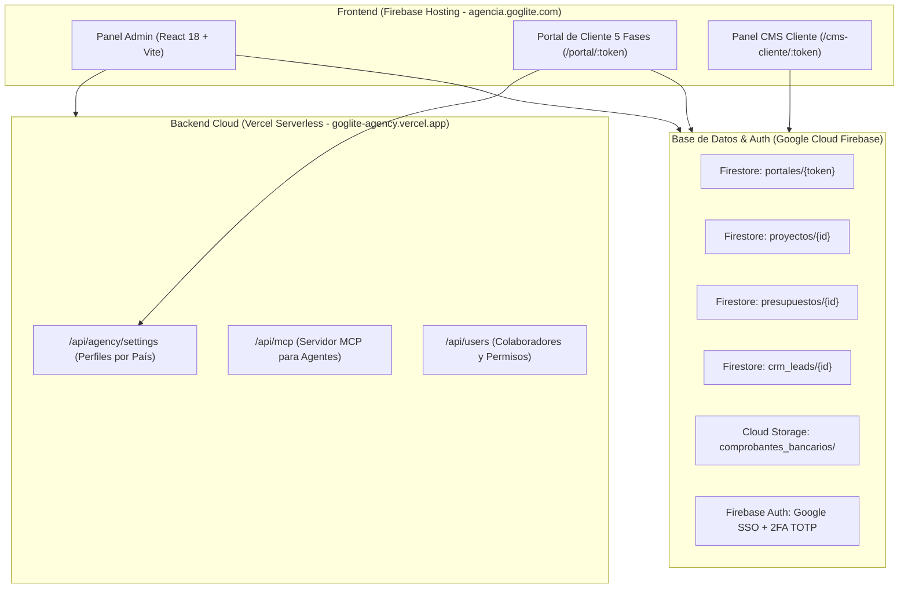

# 🚀 Documento Maestro de Progreso & Estado Técnico

**Plataforma:** Goglite Digital Hub (`agencia.goglite.com`)  
**Fecha de corte:** 25 de Octubre de 2026  
**Hora de actualización:** 22:20 (Hora local)  
**Propósito:** Consolidar el estado de avance, las funcionalidades implementadas, la arquitectura en la nube y la hoja de ruta exacta para continuar la sesión de mañana.

---

## 📌 1. Resumen Ejecutivo de la Sesión de Hoy

Durante esta sesión se completó la transición hacia una arquitectura **100% Cloud-First**, desacoplada de la computadora local, multi-sede internacional y con purga total de datos de prueba:

1. **Servidor MCP en la Nube:** Migrado y configurado en Vercel Serverless (`https://goglite-agency.vercel.app/api/mcp`) para garantizar que los agentes de IA puedan interactuar con la plataforma las 24 horas del día aunque la computadora esté apagada.
2. **Edición Manual de Leads en CRM:** Incorporado modal de edición completa en la Ficha 360 del Lead (Nombre, Empresa, Teléfono, Correo, Presencia Digital, Actividad Comercial y Notas).
3. **Catálogo Oficial de Servicios en Ajustes:** Gestor visual dinámico en la Pestaña 6 de Ajustes para dar de alta, modificar y eliminar servicios y paquetes, integrados en tiempo real al generador de presupuestos.
4. **Perfiles de Empresa por País (Multi-Sede):** Pestaña 3 de Ajustes segregada en sedes independientes (🇩🇴 República Dominicana, 🇸🇻 El Salvador, 🇺🇸 Estados Unidos) como fuente única de verdad para Razón Social, RNC/NIT/EIN, Dirección física, WhatsApp oficial y Director responsable.
5. **Purga Total de Mockups de Desarrollo:** Eliminación completa de números ficticios (`809-408-8070`, `50370001122`) y direcciones simuladas en Piantini.
6. **Resolución Automática por Procedencia de Cliente:** Las propuestas y portales asignan automáticamente los datos de contacto y facturación del país correspondiente al cliente (ej. República Dominicana para *TurisRan*).
7. **Estabilidad del Portal y Prevención de Pantallas Negras:** Corrección de dependencias circulares, orden de inicialización de hooks y contenedor `<ErrorBoundary>` global y modular.

---

## 🏢 2. Fuente Única de Verdad: Datos Institucionales de la Agencia

Configurados en el backend remoto (`/api/agency/settings`), en `src/constants/defaultAgencyBranding.js` y en `localStorage`:

| Parámetro | 🇩🇴 República Dominicana (DO) | 🇸🇻 El Salvador (SV) | 🇺🇸 Estados Unidos (US) |
| :--- | :--- | :--- | :--- |
| **Razón Social** | Goglite Digital Hub | Goglite Digital Hub | Goglite Digital Hub LLC |
| **Identificación Fiscal** | **RNC:** `1-32-45678-9` | **NIT:** `0614-290390-102-1` | **EIN / Tax ID** |
| **WhatsApp Oficial** | `+1 (829) 528-4713` | `+503 7756-9828` | `+1 (829) 528-4713` |
| **Teléfono Fijo / PBX** | `+1 (829) 528-4713` | `+503 2200-3344` | — |
| **Dirección Física** | Hermanas Mirabal #1, Plaza Herasme, 3er nivel, 11201 | Santa Ana / San Salvador, El Salvador | Miami / Florida, Estados Unidos |
| **Email Directo** | `contacto@goglite.com` | `contacto@goglite.com` | `contacto@goglite.com` |
| **Director Responsable**| Víctor Matos | Víctor Matos | Víctor Matos |
| **Cargo Institucional** | Director & Estratega Digital | Director & Estratega Digital | Director & Estratega Digital |

---

## 🏗️ 3. Estado de Módulos y Arquitectura Técnica

### Detalle por Módulos:

| Módulo | Estado | Descripción & Últimas Actualizaciones |
| :--- | :---: | :--- |
| **1. Lead Scrapper & Prospección** | ✅ 100% | Scrapper multi-país (SV, DO, US) con enriquecimiento de datos y guardado automático en CRM. |
| **2. CRM & WhatsApp Portal** | ✅ 100% | Ficha 360 con edición manual completa de datos de contacto y notas. Filtro anti-mockups. |
| **3. Presupuestos & Propuestas VIP** | ✅ 100% | Catálogo oficial de servicios inyectado, resolución automática de sede por país de cliente y ErrorBoundary. |
| **4. Contratos SOW & Onboarding** | ✅ 100% | Sincronización exacta de montos propuesta-contrato, firma digital nítida y sanitizador de precios individuales. |
| **5. Portal del Cliente (5 Fases)** | ✅ 100% | Aprobación 1-clic, Firma SOW, Entrega Drive con reloj de 10 días, Wireframes/PRD y Liquidación final. Mobile-First comprobado en iPhone. |
| **6. Centro de Desarrollo & PRD** | ✅ 100% | Generación dinámica de especificaciones según el cliente activo, arquitectura StoryBrand 7 partes. |
| **7. Launch QA & Calidad SEO** | ✅ 100% | Checklists interactivos de pre-lanzamiento, auditoría de velocidad Core Web Vitals y metaetiquetas. |
| **8. Headless CMS Hub & Portal Cliente**| ✅ 100% | Pantalla aislada `/cms-cliente/:token` con Google Auth empresarial del cliente y 3 herramientas básicas sin QR. |
| **9. Rentabilidad, P&L & Facturación** | ✅ 100% | Conciliación de anticipo y liquidación, descarga PDF de facturas comerciales unificadas. |
| **10. Ajustes Globales & Marca Blanca** | ✅ 100% | Gestor de sedes por país, catálogo oficial de servicios, 2FA TOTP y APIs con arquitectura Zero-Exposure. |

---

## 🔍 4. Verificaciones Realizadas en Vivo

Durante esta jornada se ejecutaron pruebas directas en navegadores reales vía **BrowserOS Neo**:
- **Admin Dashboard (`https://agencia.goglite.com/`):**
  - Acceso seguro mediante Google Auth + 2FA TOTP verificado.
  - Navegación al modal de Ajustes en Tab 3 (`3. Perfiles por País & Sedes`): conmutación interactiva entre `SV`, `DO` y `US` validada en el DOM sin errores.
  - Guardado de ajustes en backend remoto `/api/agency/settings` y persistencia en `localStorage`.
- **Portal de Cliente *TurisRan* (`https://agencia.goglite.com/portal/...`):**
  - Carga limpia en iPhone y escritorio sin errores de script ni pantallas negras.
  - Detección de procedencia de cliente (`DO`): Emisor asignado a *Goglite Digital Hub* en Plaza Herasme con teléfono `+1 (829) 528-4713`.
  - Botón de WhatsApp de soporte configurado dinámicamente con destino a `+1 (829) 528-4713`.

---

## 📋 5. Hoja de Ruta para la Sesión de Mañana

Al reanudar la sesión mañana, continuaremos con los siguientes puntos estratégicos:

### Prioridad 1: Prueba de Flujo Comercial E2E Completo
1. Crear un presupuesto con un servicio del nuevo catálogo (ej. *Plataforma Web Antigravity VIP con StoryBrand*).
2. Abrir el portal generado en el dispositivo móvil:
   - Aprobar propuesta en Fase 1 (1-clic).
   - Firmar contrato SOW en Fase 2 en la pantalla táctil.
   - Enviar enlace de Google Drive en Fase 3 y validar el inicio del reloj de 10 días desde el panel de la agencia.
   - Subir comprobante de liquidación en Fase 5.
3. Activar y abrir el **Portal CMS del Cliente** (`/cms-cliente/:token`) para comprobar la edición de textos y la lectura de métricas con la cuenta de Google del cliente.

### Prioridad 2: Respaldo Completo en Firestore de Módulos Restantes
- Migrar el almacenamiento de los módulos secundarios que aún guardan en `localStorage` hacia colecciones de Firestore:
  - `finanzas` (registros de ingresos/egresos del módulo de Rentabilidad).
  - `qa_audits` (historial de auditorías QA).
  - `storybrand_specs` (guiones de marca por cliente).
- Esto completará el 100% de persistencia en la nube para trabajar desde cualquier equipo de forma indistinta.

### Prioridad 3: Planificación de Despliegue en VPS Hetzner (Autohospedado)
- Definir la configuración `docker-compose.yml` para unificar:
  - Frontend SPA (Vite / Nginx).
  - Backend Node/Express + Servidor MCP.
  - Base de datos / almacenamiento local si se desea prescindir de servicios externos en el mediano plazo.
  - Certificados SSL automáticos con Caddy / Let's Encrypt.

---

## 🔐 6. Registro de Despliegues y Repositorio

- **Rama Activa:** `main`
- **Últimos Commits:**
  - `0aa075c`: *fix: corregir referencia en llamada backend al guardar ajustes*
  - `24099d1`: *fix: pass agencySettings prop to PresupuestosContratosModule and wrap root in ErrorBoundary*
  - `47df937`: *feat: perfiles de empresa independientes por pais como fuente de verdad y purga total de mockups*
  - `1b7e99d`: *feat: resolucion dinamica multisede de emisor y contacto (DO y SV) en presupuestos y portal*
- **URLs de Producción:**
  - Panel y Portales: [https://agencia.goglite.com](https://agencia.goglite.com)
  - Backend API & MCP Cloud: [https://goglite-agency.vercel.app](https://goglite-agency.vercel.app)
